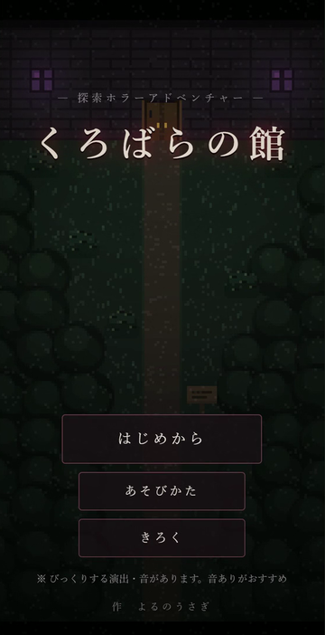
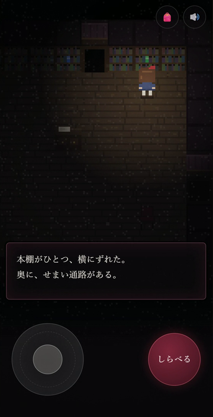

# くろばらの館

黒い薔薇に閉ざされた館から脱出する、スマホ向けの探索ホラーアドベンチャー（全4章＋おまけ）。

**遊ぶ：https://nusag1.github.io/kurobara/** （インストール不要。スマホは縦画面、PCはキーボードでも遊べます）

## できること
- 左下のスティックで歩き、「しらべる」で調べる。PC は矢印キー／WASD で歩き、Z・Enter・スペースで調べる
- ランプに火をともすと記録。死んだら最後のランプからやりなおし。タイトルの「つづきから」で再開
- 謎解き（本棚の順番、人形にオルゴールを返す、糸を切る など）と、部屋をまたいで追ってくる「追いかけっこ」
- 全4章。章ごとに新しいしくみがある（第二章：昔と今を切りかえる／第三章：4秒だけ時を止める／第四章：鏡をくぐって左右反転の館と行き来する）
- 死に方 39 種類・エンディング 11 種類を記録画面で集められる
- 4つの章の TRUE END を見ると「おまけ」（エピローグ・設定資料室・章ごとのタイムアタック）が開く
- ホーム画面に追加すればオフラインでも遊べる（PWA）

## 使った技術
- HTML / CSS / JavaScript（ライブラリ・フレームワークなし。JS は約 5,500 行）
- Canvas 2D：キャラ・マップはすべてコードで1ドットずつ描画（画像素材なし）
- Web Audio API：効果音・環境音・オルゴールをその場で合成（音声ファイルなし）
- Service Worker ＋ Web App Manifest（PWA・オフライン対応）、localStorage（章ごとの記録）
- 公開：GitHub Pages
- 補助ツール（`tools/`）：Python（itch.io 向け zip の作成、アイコン生成）、予告動画の録画・組み立て（Chrome DevTools Protocol で画面を連続撮影 → 音を合成 → ffmpeg で mp4）

## 工夫したところ・むずかしかったところ
- **章を足しても土台を作り直さない設計**：`game.js` が移動・会話・記録・追いかけっこなどのしくみを持ち、各章（`ch2.js`〜`ch4.js`）は部屋・物語・絵を足すだけにした。章ごとの新しい遊び（昔と今の切りかえ、時間停止、鏡の世界）も `game.js` 側を少し広げて対応した
- **鏡の館（第四章）**：鏡の向こうの間取りを別に描かず、元の館の座標で書いたマップを `x → w-1-x` で自動で左右反転して作る。鏡をくぐっても同じ座標に出るので、「鏡の向こうでは反対がわ」という謎解きがそのまま成り立つ。物の絵は反転して描き、文字は CSS で鏡文字にした
- **時間停止（第三章）**：ゆれる刃・転がる歯車・一瞬だけ開く扉など動く危険物を、止めている間だけ全部止める。追いかけっこも止まる
- **前の記録を壊さない**：章やおまけを足すたびに、保存の形（meta）にはフィールドを足すだけにして、以前のセーブがそのまま読めるようにした
- **似すぎチェック**：既存作品と似すぎないよう場面や設定を見直し、演出・設定を差しかえた（[SPEC.md](SPEC.md) の 8 章）

## 作り方
企画・仕様・設計の判断は自分で行い、コードは AI（Claude）と一緒に書きました。仕様と決めたことの記録は [SPEC.md](SPEC.md) にあります。

## ファイル
| ファイル | 中身 |
|---|---|
| `index.html` / `style.css` | 画面 |
| `game.js` | 共通のしくみ（描画・移動・会話・記録・追いかけっこ）と第一章 |
| `ch2.js` / `ch3.js` / `ch4.js` | 第二〜四章 |
| `omake.js` | おまけ（エピローグ・設定資料室・タイムアタック） |
| `sw.js` / `manifest.webmanifest` | オフライン対応・ホーム画面用 |
| `SPEC.md` | 条件定義書（仕様と変更の記録） |

各章の中身（ネタバレを少し含みます）

## 第一章『くろばらの館』
- 部屋：森の小道／玄関ホール／書斎／隠し部屋／東の廊下／台所／二階（子ども部屋）／魔女の部屋
- 謎解き：本棚の順番・人形にオルゴールを返す・糸を切る、など
- 死に方 9 種類（記録画面で集められる）、エンディング 2 種類（NORMAL／TRUE）
- 追いかけっこ 2 回（部屋をまたいで追ってくる）

## 第二章『魔女の時計塔』（第一章をクリアすると遊べる）
- 一年後。弟ソウタが森で消え、黒い花びらをたどると 3時33分で止まった時計塔へ
- 部屋：森のはずれ／中庭／時計のホール／台所／温室／書庫／セナの部屋／地下工房／歯車の間／文字盤の部屋
- 懐中時計（⌛・PCは C キー）で「昔」と「今」を切りかえる。昔にうめた種が、今は蔓になって二階へのぼれる、など
- 時計守は「今」にしかいない。たんすに「かくれる」追いかけっこもある。鏡の中のミナがヒントをくれる
- 死に方 10 種類、エンディング 3 種類（NORMAL／TRUE／ANOTHER）
- 中身は `ch2.js`（`game.js` のしくみに部屋・物語・絵を足している）

## 第三章『ソウタの懐中時計』（第二章をクリアすると遊べる）
- 第二章 ANOTHER END のその後。七年後、12歳になったソウタが、名前を忘れて「時計守」になったリコを取りもどしに塔へ
- 部屋：森の入口／枯れた中庭／止まったホール／刃の廊下／人形の工房／書庫／上の回廊／時計守の部屋／歯車の間／鐘の間
- 懐中時計（⏱・PCは C キー）で4秒だけ時を止める（止めたあと5秒は巻き直し）。ゆれる刃・一瞬だけ開く扉・転がる歯車・追ってくる時計守が止まる
- 「リコの思い出」を4つ集めて、時を止めた中で名前を呼ぶと TRUE
- 死に方 10 種類、エンディング 3 種類（NORMAL／TRUE／ANOTHER）
- 中身は `ch3.js`

## 第四章『鏡の向こうの館』（第三章のどれかのエンディングで遊べる）
- 白い薔薇の原っぱの、ひびだらけの鏡に、鏡文字で「リコ、たすけて」。鏡をくぐると、明かりのともった「鏡の館」へ
- 部屋：白い薔薇の原っぱ／鏡の庭／玄関ホール／書斎／廊下／台所／衣装部屋／二階の廊下／おかあさんの部屋／こども部屋（衣装部屋と原っぱ以外は「鏡の館」と「くろばらの館」の両がわがある）
- 館の鏡をしらべると、鏡の向こうへくぐれる。向こうは**左右はんたい**の間取り。片がわにしかない物（はさみ・日記など）、片がわにしかない扉、鏡からしか入れない部屋がある
- 鏡の館の字は**鏡文字**（左右反転）で出る。衣装部屋の手鏡を手に入れると読める
- 謎解き：くろばらがわのろうそくと「同じ場所」に火をともす（鏡の向こうでは、はんたいがわ）／黒い蔓をはさみで切る／門のあいことば
- 追いかけっこ 2回（鏡からぬけ出した「もうひとりのリコ」は、鏡をくぐれば振りきれる／さいごは鏡のミナ）
- 「古い日記」を4枚集めて、あの子のほんとうの名前をよぶと TRUE
- 死に方 10 種類、エンディング 3 種類（NORMAL／TRUE／ANOTHER）
- 中身は `ch4.js`

## おまけ（四つの章の TRUE END をすべて見ると解放）
- タイトルに TRUE END の数（例：`TRUE END 2/4`）が出る。4/4 になると「おまけ」ボタンが増える（2026-10-22 に第四章の TRUE も条件に追加）
- エピローグ『白い薔薇の朝』：館があった原っぱで、ソウタ・魔女リラの手紙・鏡の中のミナと。次のお話『鏡の向こうの館』をちょっとだけのぞかせる（記録はしない短いシーン）
- 設定資料室：人物（見たエンディングに合わせて書いてあることがふえる）／部屋の作者メモ（章ごと）／死に方とエンディングの図鑑（集めたものだけ、作者のひとこと付き）／タイム／章えらび（クリアした章のはじめへ・エピローグ）
- タイムアタック：「はじめから」遊んだ回のクリアまでの時間を章ごとに計る（ランプからのやりなおしも含む。メニューを開いているあいだは止まる）。エンディング画面と資料室に、そのときのタイムとベストを出す。以前の記録の「つづきから」では計らない
- 第四章を遊ぶと、資料室にも第四章の人物・部屋・図鑑・タイムがふえる
- 中身は `omake.js`。記録は今までの meta に `run`（遊んでいる回の経過秒）と `best`（章ごとの最速）を足しただけなので、前の記録もそのまま使える

